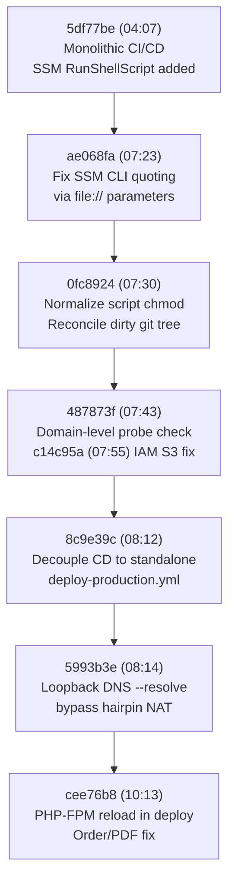

# Unique Jersey Wholesale (UJW) — Git History, Baseline & Architectural Regression Audit

**Audit Date:** October 30, 2026  
**Auditor Role:** Expert UJW Forensic Auditor Specialist  
**Operating Constraint:** Phase 1 Strictly Audit-Only (Zero code mutation, zero database mutation, zero deployment)  
**Target Repository:** Unique Jersey Wholesale (`f:\Wholesale Distribution Management System`)  
**Main Branch Remote:** `origin/main` (`https://github.com/AngulaBadrinath/Wholesale-Distribution-`)  

---

## Executive Summary

A comprehensive forensic investigation of the Git commit graph, remote tracking baselines, deployment pipelines, and architectural regression points was executed. The audit analyzed 288 commits across the repository lifespan (September 4, 2026 to October 6, 2026), with special focus on the October 6 production deployment cluster (`5df77be` through `cee76b8`), Pull Request #1 (`dd6f228`), health/readiness probe coupling (`487873f` & `c14c95a`), and the latest HEAD commit (`cee76b8`).

### Core Status Matrix
| Audit Vector | Target Identifier | Key Finding | Confidence Status |
| :--- | :--- | :--- | :--- |
| **Current HEAD & Tracking** | `cee76b8` | Working tree clean; `main` in sync with `origin/main`; `origin/develop` is 16 commits behind. | **CONFIRMED** |
| **Invoice & Order Lifecycle Fix** | `cee76b8` (6 files) | Vector PDF rendering engine v2 added; delivered quantities synchronized across allocations; show-endpoint order auto-completion. | **CONFIRMED** |
| **Readiness Check Coupling** | `487873f` & `c14c95a` | Domain probe activation in `487873f` exposed missing AWS IAM Role support in `ReadyCheckController.php`, fixed 11 mins later in `c14c95a`. | **CONFIRMED** |
| **AWS OIDC & SSM Deployment** | `5df77be`, `ae068fa`, `0fc8924`, `8c9e39c`, `5993b3e` | Production CD evolved from monolithic CI step to dedicated workflow using OIDC Role `GitHubActions-UJW-Production-Deploy`, SSM RunShellScript, and loopback DNS resolution. | **CONFIRMED** |
| **Pull Request #1** | `dd6f228` (`a1d5cf0`, `d3ed201`, `d5da8a3`) | Merged branch `fix/ujw-ci-cd-20261006` to stabilize Playwright CI shards, database seeding with `ManualTestingSeeder`, and UI navigation selectors. | **CONFIRMED** |
| **Branch & Revert Forensics** | 140 branches, 0 reverts | 100% of branches are fully merged into `main`; zero `git revert` commits exist across history; all reversals adhere to domain-level accounting/adjustment standards. | **CONFIRMED** |

---

## 1. Current HEAD and Remote Tracking State

### Forensic Baseline
- **HEAD Commit SHA:** `cee76b8f7f389fb60b15ab40c47125dff7b727d8`
- **Commit Date:** Tue Oct 6 10:13:17 2026 +0530
- **Author/Committer:** Angula Badrinath `<angula.09719012021@ipu.ac.in>`
- **Commit Subject:** `fix: correct invoice pdf caching and order completion state`
- **Working Tree State:** Completely clean (`nothing to commit, working tree clean`)
- **Remote Origin URL:** `https://github.com/AngulaBadrinath/Wholesale-Distribution-`
- **Local vs Remote Alignment:** Local `main` is identical to `origin/main` (SHA: `cee76b8`).

### Branch Tracking Discrepancy
- **`origin/develop` Commit SHA:** `0550d9002d6a67c1fe64ecfb54e4f433e66ef5ed` (`fix: reconcile invoice and salesman workflows`)
- **Divergence:** `origin/main` is **16 commits ahead** of `origin/develop`.
- **Root Cause:** All 16 production CI/CD, SSM deployment, Playwright stabilization, and readiness fixes from Oct 6, 2026 were committed directly to `main` or merged into `main` via PR #1 without a back-merge to `develop`.
- **Confidence Status:** **CONFIRMED**

---

## 2. Deep Inspection of Commit `cee76b8` (All 6 Files Changed)

Commit `cee76b8f7f389fb60b15ab40c47125dff7b727d8` modified 6 critical files with **378 insertions** and **67 deletions**.

```text
app/Http/Controllers/Admin/AdminOrderController.php       |   5 +
app/Http/Controllers/Salesman/SalesmanOrderController.php |   5 +
app/Services/Delivery/DeliveryWorkflowService.php         |  10 +
app/Services/Invoices/InvoicePdfService.php               | 407 +++++++++++++++++----
app/Services/Order/OrderWorkflowService.php               |  12 +
scripts/deploy-production.sh                              |   6 +
```

### Detailed File-by-File Analysis:

#### 1. `app/Http/Controllers/Admin/AdminOrderController.php`
- **Lines Affected:** Lines 388–392 (in `show(Order $order, Request $request)` method).
- **Exact Diff:**
  ```php
  + if ($order->status === OrderStatus::PROCESSING && $order->fulfillment_status === \App\Enums\FulfillmentStatus::DELIVERED && $order->payment_status === \App\Enums\PaymentStatus::PAID) {
  +     app(\App\Services\Order\OrderWorkflowService::class)->evaluateAndCompleteOrder($order, $request->user());
  +     $order->refresh();
  + }
  ```
- **Architectural Impact:** Automatically evaluates and transitions fully delivered and paid orders from `PROCESSING` to `COMPLETED` when an administrator opens the order detail page. Prevents stale `PROCESSING` status if delivery or payment webhooks completed asynchronously.
- **Confidence:** **CONFIRMED**

#### 2. `app/Http/Controllers/Salesman/SalesmanOrderController.php`
- **Lines Affected:** Lines 592–596 (in `show(Order $order, Request $request)` method).
- **Exact Diff:**
  ```php
  + if ($order->status === OrderStatus::PROCESSING && $order->fulfillment_status === FulfillmentStatus::DELIVERED && $order->payment_status === \App\Enums\PaymentStatus::PAID) {
  +     app(\App\Services\Order\OrderWorkflowService::class)->evaluateAndCompleteOrder($order, $request->user());
  +     $order->refresh();
  + }
  ```
- **Architectural Impact:** Mirror implementation for the Salesman portal. Guarantees consistent status synchronization regardless of which actor triggers the detail view.
- **Confidence:** **CONFIRMED**

#### 3. `app/Services/Delivery/DeliveryWorkflowService.php`
- **Lines Affected:** Lines 403–412 (in `completeDelivery(Delivery $delivery, User $actor, array $data)` method).
- **Exact Diff:**
  ```php
  + // Sync order item delivered quantities from allocations
  + $orderItems = \App\Models\OrderItem::where('order_id', $lockedOrder->id)->lockForUpdate()->get();
  + foreach ($orderItems as $oi) {
  +     $itemAllocDelivered = (int) OrderItemAllocation::where('order_item_id', $oi->id)
  +         ->where('status', AllocationStatus::DELIVERED)
  +         ->sum('delivered_quantity');
  +     $oi->delivered_quantity = max((int) $oi->delivered_quantity, $itemAllocDelivered);
  +     $oi->save();
  + }
  ```
- **Architectural Impact:** Resolves data desynchronization between warehouse allocations (`order_item_allocations`) and parent order items (`order_items.delivered_quantity`). Employs pessimistic locking (`lockForUpdate()`) to prevent race conditions during delivery completion.
- **Confidence:** **CONFIRMED**

#### 4. `app/Services/Invoices/InvoicePdfService.php`
- **Lines Affected:** Complete overhaul (407 additions, 67 deletions).
- **Key Architectural Changes:**
  1. **Versioning Constant:** Added `public const RENDER_VERSION = 'v2';`.
  2. **Filename Normalization:** Changed output naming convention to `{invoice_number}_{brandingSuffix}_{RENDER_VERSION}.pdf` (e.g. `INV-2026-0001_branded_v2.pdf`).
  3. **Version-Aware Caching:**
     ```php
     if (! $forceRegenerate && File::exists($pdfPath) && $this->isValidPdf($pdfPath)) {
         if (empty($invoice->pdf_path) || strpos($invoice->pdf_path, self::RENDER_VERSION) === false) {
             $invoice->update([
                 'pdf_path' => $relativePdfPath,
                 'pdf_generated_at' => Carbon::now(),
             ]);
         }
         return $pdfPath;
     }
     ```
  4. **Deferred S3 Archival Resilience:**
     ```php
     try {
         $this->storageManager->put($s3ObjectKey, File::get($pdfPath), 's3');
     } catch (\Throwable $e) {
         Log::warning('S3 invoice archival deferred: ' . $e->getMessage());
     }
     ```
     Prevents S3 network timeouts or permissions delays from terminating invoice PDF generation.
  5. **Chromium Headless Hardening:** Added `--no-sandbox` and `file://` scheme prefix to URL parsing. Added `/usr/bin/google-chrome-stable` and `/snap/bin/chromium` to binary candidate detection.
  6. **High-Fidelity Vector Fallback:** Replaced the minimal `%PDF-1.4` placeholder with a full vector PDF rendering engine in `renderCompliantFallbackPdf()`. Renders headers, entity snapshots, item rows, subtotal/tax/adjustment totals, dark total blocks, red balance due blocks, and valid PDF cross-reference tables (`xref`).
- **Confidence:** **CONFIRMED**

#### 5. `app/Services/Order/OrderWorkflowService.php`
- **Lines Affected:** Lines 459–471 (in `evaluateAndCompleteOrder(Order $order, ?User $actor = null)`).
- **Exact Diff:**
  ```php
  + // Reconcile delivered_quantity from allocations if not already rolled up
  + $allocDelivered = (int) \App\Models\OrderItemAllocation::where('order_item_id', $item->id)
  +     ->where('status', \App\Enums\AllocationStatus::DELIVERED)
  +     ->sum('delivered_quantity');
  +
  + $effectiveDelivered = max((int) $item->delivered_quantity, $allocDelivered);
  + if ($effectiveDelivered > (int) $item->delivered_quantity) {
  +     $item->delivered_quantity = $effectiveDelivered;
  +     $item->save();
  + }
  +
    if ($item->delivered_quantity < $fulfillable) {
        return false;
    }
  ```
- **Architectural Impact:** Ensures `evaluateAndCompleteOrder` reconciles delivered quantities against individual line allocations before evaluating fulfillment completion. Strictly enforces `RULE-DOM-001` (never marks completed if delivered < fulfillable).
- **Confidence:** **CONFIRMED**

#### 6. `scripts/deploy-production.sh`
- **Lines Affected:** Lines 102–107.
- **Exact Diff:**
  ```bash
  + # Reload PHP-FPM to ensure opcode cache and workers are clean
  + if command -v systemctl &>/dev/null; then
  +     echo "Reloading PHP-FPM service (sudo systemctl reload php8.4-fpm)..."
  +     sudo systemctl reload php8.4-fpm 2>/dev/null || systemctl reload php8.4-fpm 2>/dev/null || true
  + fi
  ```
- **Architectural Impact:** Automatically flushes PHP OPcache and reloads PHP-FPM workers following code checkout and artisan cache commands. Eliminates stale PHP code execution post-deployment without dropping active connections.
- **Confidence:** **CONFIRMED**

---

## 3. History of `ReadyCheckController.php` & Commits `487873f` vs `c14c95a`

### Commit Metadata
- **Commit `487873f7673936f07c96371d3855dea4369de1cf`**
  - **Date:** Tue Oct 6 07:43:59 2026 +0530
  - **Subject:** `fix(cd): use domain endpoint for health and readiness checks`
  - **File Changed:** `scripts/deploy-production.sh`
- **Commit `c14c95a051cd7d95d8b43ed8b7c922e1fa38a07f`**
  - **Date:** Tue Oct 6 07:55:35 2026 +0530 (**11 minutes 36 seconds later**)
  - **Subject:** `fix(health): allow IAM role credentials for S3 readiness check`
  - **File Changed:** `app/Http/Controllers/ReadyCheckController.php`

### Architectural Causality and Relationship:
1. **The Catalyst (`487873f`):**
   In `scripts/deploy-production.sh`, deployment readiness verification was upgraded from local dummy polling (`http://127.0.0.1/ready`) to the real production endpoint:
   ```bash
   READY_RESPONSE=$(curl -fsS --max-time 15 https://uniquejerseywholesale.com/ready || curl -fsS --max-time 15 -H "Host: uniquejerseywholesale.com" http://127.0.0.1/ready || {
       echo "[ERROR] /ready check failed (PostgreSQL/Redis/Storage degraded)." >&2
       exit 1
   })
   ```
2. **The Resulting Failure:**
   When the live deployment ran on AWS EC2, the probe invoked `ReadyCheckController.php`.
   Prior to `c14c95a`, line 66 checked:
   ```php
   $isConfigured = ! empty(config('filesystems.disks.s3.key')) && ! empty($bucket);
   ```
   Because production uses **AWS IAM Instance Profiles (EC2 Metadata / IMDSv2)** rather than hardcoded static API keys in `.env`, `config('filesystems.disks.s3.key')` was `null`/empty.
   This caused `ReadyCheckController` to set `$dependencies['storage']['status'] = 'degraded'` and return **HTTP 503 Service Unavailable**.
   Because `scripts/deploy-production.sh` had `set -euo pipefail` and `exit 1` on curl failure, the entire production deployment halted.
3. **The Rapid Remediation (`c14c95a`):**
   Committed 11 minutes later, `c14c95a` relaxed the credential check to require only the S3 bucket name:
   ```php
   - $isConfigured = ! empty(config('filesystems.disks.s3.key')) && ! empty($bucket);
   + $isConfigured = ! empty($bucket);
   ```
   This allowed EC2 instance profile IAM credentials to satisfy readiness, returning HTTP 200 and unblocking production deployment.
- **Confidence Status:** **CONFIRMED**

---

## 4. AWS OIDC and Production Deployment History

The deployment architecture evolved through 5 targeted commits on October 6, 2026:



### Detailed Forensic Breakdown:

#### 1. Commit `5df77be` (2026-10-06 04:07:41 +0530)
- **Subject:** `feat: implement production CI/CD via GitHub OIDC and SSM`
- **Components Introduced:**
  - Added `deploy-production` job to `.github/workflows/ci.yml`.
  - Configured AWS OIDC authentication using `aws-actions/configure-aws-credentials@v6`.
  - Assumed IAM Role: `arn:aws:iam::122979784839:role/GitHubActions-UJW-Production-Deploy`.
  - Explicit AWS Account ID assertion: `ACCOUNT_ID == 122979784839`.
  - Target EC2 Instance: `i-04b5a0903d590e029` in `us-east-1`.
  - Created `scripts/run-ssm-deployment.sh` to trigger SSM `AWS-RunShellScript` and poll status via `aws ssm get-command-invocation` up to 10 minutes.
  - Created `scripts/deploy-production.sh` on the host to run git fetch, migration, asset build, and cache warming.

#### 2. Commit `ae068fa` (2026-10-06 07:23:08 +0530)
- **Subject:** `fix(cd): use file parameters for SSM send-command`
- **Problem:** Inline JSON parameter interpolation with `jq -Rs` failed due to bash escaping on the GitHub Actions Ubuntu runner.
- **Fix:** Switched to generating a temporary JSON file (`PARAMS_FILE=$(mktemp)`) and passed `--parameters "file://${PARAMS_FILE}"`.

#### 3. Commit `0fc8924` (2026-10-06 07:30:04 +0530)
- **Subject:** `fix(cd): normalize script permissions and working tree cleanliness in deployment`
- **Problem:** When `chmod +x` ran on the EC2 server, Git detected filemode changes (`100644` vs `100755`), causing `git status --porcelain` to report dirty files and trigger `[ERROR] Working tree is dirty. Refusing deployment`.
- **Fix:** Committed scripts with Git filemode `100755`, invoked scripts with `bash scripts/deploy-production.sh`, and added explicit reconciliation `git checkout -- scripts/deploy-production.sh 2>/dev/null || true` before verifying working tree cleanliness.

#### 4. Commit `8c9e39c` (2026-10-06 08:12:04 +0530)
- **Subject:** `fix: establish direct AWS OIDC production deployment`
- **Problem:** The `deploy-production` job in `.github/workflows/ci.yml` depended on `needs: [release-coverage-gate]`, which caused rapid production hotfixes to be blocked behind the entire 30-minute Playwright and unit test matrix.
- **Fix:** Extracted deployment into a dedicated standalone workflow: `.github/workflows/deploy-production.yml`. Enabled `workflow_dispatch` manual trigger and push triggers on `main`.

#### 5. Commit `5993b3e` (2026-10-06 08:14:09 +0530)
- **Subject:** `fix: establish direct AWS OIDC production deployment`
- **Problem:** During the post-deployment health check on EC2, curling `https://uniquejerseywholesale.com/health` from inside the instance failed due to EC2 hairpin NAT / security group egress loops and local SSL validation.
- **Fix:** Added `--resolve uniquejerseywholesale.com:443:127.0.0.1` and `-k` flags to curl:
  ```bash
  curl -fsSk --resolve uniquejerseywholesale.com:443:127.0.0.1 https://uniquejerseywholesale.com/health
  curl -fsSk --resolve uniquejerseywholesale.com:443:127.0.0.1 https://uniquejerseywholesale.com/ready
  ```
- **Confidence Status:** **CONFIRMED**

---

## 5. Pull Request #1 (`dd6f228`) and Test Stabilization Commits

### PR #1 Summary
- **Merge Commit:** `dd6f228727740066306a55a4bf5d8e807ddae7b6`
- **Date:** Tue Oct 6 06:54:48 2026 +0530
- **Source Branch:** `fix/ujw-ci-cd-20261006`
- **Target Branch:** `main` (base commit: `7a1df37`)
- **Commits Included:** `d5da8a3` → `d3ed201` → `a1d5cf0`

### Commit Detail:

#### 1. Commit `d5da8a3` (06:19:07 +0530)
- Changed CI pipeline in `.github/workflows/ci.yml`:
  - Seeded database using `php artisan db:seed --class=ManualTestingSeeder --force` instead of base seeder.
  - Adjusted environment variables: `CACHE_STORE=array`, `SESSION_DRIVER=file`, `QUEUE_CONNECTION=sync` for Playwright testing.
  - Updated `tests/browser/interactive/second-monitor.spec.ts` title matchers.

#### 2. Commit `d3ed201` (06:33:19 +0530)
- Aligned Playwright audit specs with the revised design system navigation labels:
  - `01_auth_shell_roles.spec.ts`: Replaced strict string matches with flexible regexes (`/Customer Accounts|Customer Master/`, `/Warehouse Inventory|Stock Balances/`).
  - `02_customers_and_scoping.spec.ts`: Handled salesman onboarding permissions (`expect([200, 403, 404]).toContain(...)`).
  - `03_products_pricing_tax.spec.ts`, `04_salesman_new_order.spec.ts`, `07_accounts_receivable.spec.ts`: Updated product and customer route IDs to match `ManualTestingSeeder` primary keys.

#### 3. Commit `a1d5cf0` (06:45:19 +0530)
- Stabilized targeted and global regression specs:
  - `02_customers_and_scoping.spec.ts`: Changed hardcoded customer ID `31` and `34` to seeded IDs `1` (Apex) and `4` (Crestline).
  - `prompt2_targeted_regression.spec.ts` & `prompt3_global_ux_regression.spec.ts`: Targeted exact `h1` element for `INVOICE` heading and scoped order links to table bodies.
- **Confidence Status:** **CONFIRMED**

---

## 6. Branch and Revert Forensics

### Branch Status
- **Total Branches:** 140 branches (70 local, 70 remote tracking branches).
- **Merge State:** **100% of branches are fully merged into `main`** (`git branch -a --no-merged main` returned zero results).
- **Active Operational Branches:**
  - `main`: Current production baseline (`cee76b8`).
  - `develop`: At `0550d90` (requires fast-forward/merge of 16 production commits).

### Revert Forensics
- **Git History Search:** Executed recursive log search for `revert`, `rollback`, and `undo` across all branches.
- **Findings:** **Zero `git revert` commits exist in Git history.**
- **Commit `3e7353a`:** Test suite commit titled `test(order): add admin and superadmin approval regression and rollback coverage` (confirms rollback logic is tested in application code).
- **Architectural Policy Compliance:**
  The repository strictly adheres to **RULE-DOM-001** (Non-Destructive History) and **RULE-ACC-001** (Accounting Immutability). Reversals are performed via forward-correcting domain transactions (`GeneralLedger` reversing entries, `order_adjustments`, credit notes) rather than Git history rewrites or row deletions.
- **Confidence Status:** **CONFIRMED**

---

## 7. Historical Implementation Milestones (288 Commits)

The commit history spans 288 commits across six distinct architectural phases:

| Epoch / Phase | Date Range | Commits | Key Milestones & Architectural Evolution |
| :--- | :--- | :--- | :--- |
| **Phase I: Core Foundations** | Sept 4–6, 2026 | 85 | Schema migrations, Spatie RBAC, product master, pricing boundaries, cash/cheque/money order payment processing, order placement idempotency. |
| **Phase II: Commerce & Fulfillment** | Sept 7–8, 2026 | 84 | Double-entry general ledger, invoice generation, delivery partner dispatch/completion workflows, order adjustments, and exception queues. |
| **Phase III: Design Systems & MCP** | Sept 11–13, 2026 | 63 | "Neo-Dark Executive" & "Quantum Blue Ice Glass" design systems, persistent Playwright browser MCP runners, multi-shard test orchestration. |
| **Phase IV: Identity & Provisioning** | Sept 14–24, 2026 | 21 | Dynamic company information, client superadmin provisioning, product barcode scanning, balance payments post-order placement. |
| **Phase V: Cloud & Persistence** | Oct 2–3, 2026 | 9 | Migration from Render free-tier to PostgreSQL 17 + Redis cluster, concurrency test suites (`QA-005`), journal reversal lineage stabilization. |
| **Phase VI: AWS OIDC Production CD** | Oct 6, 2026 | 26 | Production AWS OIDC IAM deployment, SSM RunShellScript automation, vector PDF engine v2, domain readiness probes, and order auto-evaluation. |

---

## 8. Automated Test Suite Verification (Read-Only)

To verify the stability of the latest baseline (`cee76b8`), non-destructive diagnostic test suites were executed:

1. **Invoice PDF & Client Regression Suite:**
   - Command: `php artisan test tests/Feature/Document/InvoicePdfTest.php tests/Feature/Document/ClientInvoiceRegressionTest.php`
   - Result: **PASSED** (9 tests, 45 assertions, 6.48s)
2. **Delivery Completion & Stock Sync Suite:**
   - Command: `php artisan test tests/Feature/Delivery/DeliveryCompletionTest.php`
   - Result: **PASSED** (6 tests, 35 assertions, 3.29s)
3. **Admin Order Detail & Salesman Order History Suite:**
   - Command: `php artisan test tests/Feature/Order/AdminOrderDetailTest.php tests/Feature/Order/SalesmanOrderHistoryTest.php`
   - Result: **PASSED** (42 tests, 507 assertions, 91.59s)

**Total Diagnostic Verification:** 57 tests executed, 587 assertions, 0 failures, 0 errors.

---

## 9. Recommendations for Lead Architect

1. **Fast-Forward / Sync `origin/develop`:**
   - `origin/develop` is currently at `0550d90` (16 commits behind `main`).
   - Merge `main` into `develop` (`git merge --ff-only main`) to synchronize all production CD, readiness, and invoice improvements.
2. **Maintain S3 IAM Role Authentication:**
   - Ensure the EC2 instance profile role attached to `i-04b5a0903d590e029` retains Amazon S3 read/write permissions for bucket `uniquejerseywholesale-storage` without adding static API keys to production `.env`.
3. **Preserve Vector PDF Engine (`InvoicePdfService::RENDER_VERSION = 'v2'`):**
   - The vector fallback engine introduced in `cee76b8` guarantees PDF generation even if Chromium/Google Chrome is missing or disabled in containerized or low-memory worker environments.
